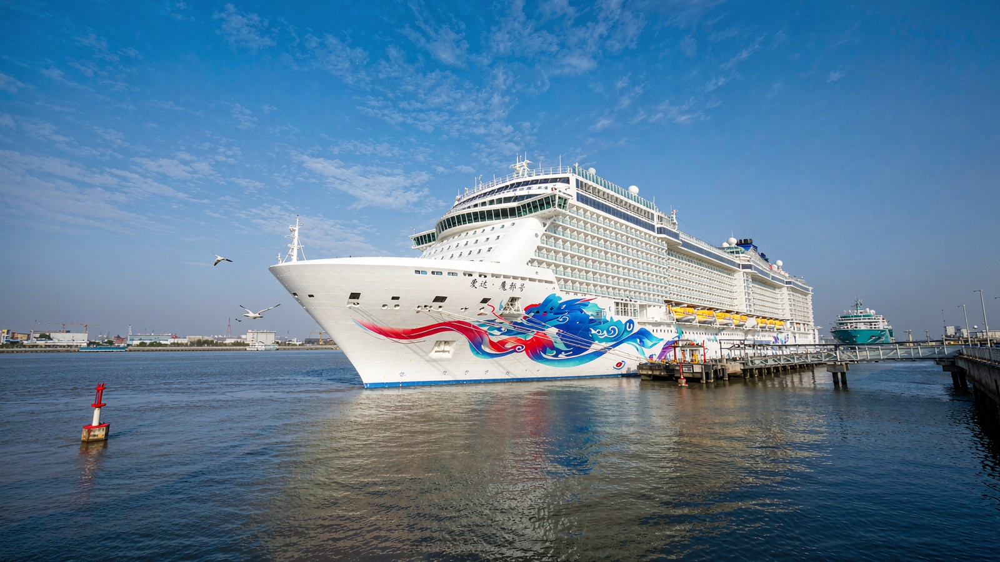

# 任务二 + 任务三 · 代码展示

姓名：朱思冰　学号：24001010915　班级：9 班 15 号
时间：2026-11-06　模型：DeepSeek-V4.1-Flash（WorkBuddy 环境）

| 任务 | 在线页面 | 主要文件 |
|---|---|---|
| 任务二 · creative 仿写 | https://dashing-malabi-85186b.netlify.app/swiper-p2.html | `swiper-p2.html` + `js/zsb_swiper_p2.js` |
| 任务三 · 综合创作 | https://dashing-malabi-85186b.netlify.app/swiper-p3.html | `swiper-p3.html` + `js/zsb_swiper_p3.js` + `swiper-expo.css` |

---

# 任务二 · creative 仿写（课堂没讲的效果）

## 1. 我在官方示例里看到了什么

官方 `demos/257-effect-creative.html` 的思路只有一句话：

> **`creativeEffect` 里的 `prev` 和 `next`，分别描述"上一张此刻停在哪、下一张此刻停在哪"。**

每一边最多写四个属性：

| 属性 | 管什么 | 我的取值 | 视觉结果 |
|---|---|---|---|
| `translate` | 位移，`[x, y, z]` | prev `['-55%', 0, -120]` / next `['55%', 0, -40]` | 上一张往左移开并后退，下一张从右边靠过来 |
| `rotate` | 旋转，`[x, y, z]` 角度 | prev `[0, 0, -10]` / next `[0, 0, 6]` | 上一张逆时针歪 10°，下一张顺时针歪 6° |
| `scale` | 缩放 | prev `0.8` / next `1.08` | 上一张缩小、下一张放大，形成"抽卡"层次 |
| `opacity` / `shadow` | 透明度 / 投影 | prev `0.9`，都开 `shadow` | 上一张略微变暗，卡片有厚度 |

## 2. 完整代码（`js/zsb_swiper_p2.js` 核心部分）

```js
var zsb_rotate_z = -10;      // 上一张的 Z 轴角度，按钮会改这个值

function zsb_build() {
  var zsb_el = document.querySelector('#zsbSw2');
  if (!zsb_el || typeof window.Swiper !== 'function') {
    return null;
  }

  return new window.Swiper('#zsbSw2', {
    loop: true,
    speed: 600,
    grabCursor: true,
    effect: 'creative',
    creativeEffect: {
      prev: {                                   // 上一张停在哪
        translate: ['-55%', 0, -120],           // 向左移出 55%，并后退 120px
        rotate: [0, 0, zsb_rotate_z],           // 逆时针歪（默认 -10°）
        scale: 0.8,                             // 缩小到 80%
        opacity: 0.9,
        shadow: true
      },
      next: {                                   // 下一张停在哪
        translate: ['55%', 0, -40],             // 在右后方 55% 处待命
        rotate: [0, 0, 6],                      // 顺时针歪 6°
        scale: 1.08,                            // 放大 8%，形成"冒头"感
        shadow: true
      }
    },
    pagination: { el: '#zsbPag2', clickable: true },
    navigation: { prevEl: '#zsbPrev2', nextEl: '#zsbNext2' }
  });
}
```

### 追问"改成 20 度"怎么实现

Swiper 创建后参数不能再改（`creativeEffect` 是初始化时算好的），所以做法是**销毁 + 重建**：

```js
function zsb_switch_rotate(zsb_value, zsb_button) {
  zsb_rotate_z = zsb_value;                       // 换角度

  // 先清掉所有按钮的选中态，再把当前按钮点亮
  document.querySelectorAll('.zsb_btns .zsb_btn').forEach(function (zsb_item) {
    zsb_item.classList.remove('zsb_on');
  });
  if (zsb_button) { zsb_button.classList.add('zsb_on'); }

  if (zsb_swiper && !zsb_swiper.destroyed) {
    zsb_swiper.destroy(true, true);               // 连 DOM 上的样式一起清掉
  }
  zsb_swiper = zsb_build();                       // 用新角度重建
}
```

## 3. 答辩两问

**问 1：`transform` 里的百分比是相对谁的？**

相对**元素自身**的宽高，不是相对父容器。`translate: ['-55%', 0, -120]` 意思是"往左挪自身宽度的 55%"，所以无论轮播容器多宽，卡片露出的比例始终一样，换屏幕尺寸不会错位。
顺带一句：`translate` 的第三个数 `z` 是像素，不是百分比——**百分比只能用在 x 和 y 上**，z 轴没有"自身厚度"可参照。

**问 2：改一个数值让卡片转 20 度，怎么做？**

改 `creativeEffect.prev.rotate` 的第三个值（Z 轴）。但注意两件事：
① 改完必须**重建实例**，因为 `creativeEffect` 在初始化时就已经算成 transform 写进样式了；
② 只看 prev 会觉得不够明显——20° 时上一张的边角会明显翘起，配合 `scale: 0.8` 才看得出"歪着缩到后面"的立体感。所以我在页面上把"默认 -10°"和"20°"做成了两个按钮，点一下就能对比。

---

# 任务三 · 综合创作（新增展品 + 新能力 + 答辩）

## 1. 三件事

| 事项 | 做法 |
|---|---|
| ① 新增第六件展品 | 「爱达·魔都号」（首艘国产大型邮轮，2024-01 首航），图片用 AI 生成后裁成 **16:9（1600×900）**，slide 结构与前五张完全一致 |
| ② 新能力一：keyboard | `keyboard: { enabled: true, onlyInViewport: true }`，方向键 ← → 翻页 |
| ③ 新能力二：parallax | `parallax: true` + 元素上的 `data-swiper-parallax`，标题比图片动得快 |

> 题目说 keyboard / mousewheel / zoom 任选其一，我选了 **keyboard**，因为它是唯一"不依赖鼠标"的方式，答辩时也最好演示——按一下方向键，六张展品就能依次翻过去。

## 2. 完整初始化代码（`js/zsb_swiper_p3.js`）

```js
function zsb_build() {
  var zsb_el = document.querySelector('#zsbExpo');

  if (!zsb_el || typeof window.Swiper !== 'function') {
    return null;
  }

  return new window.Swiper('#zsbExpo', {
    loop: true,          // 六张展品首尾相接
    speed: 900,          // 一次切换 900ms，比默认慢，更有"展厅"的从容感
    parallax: true,      // 打开视差

    keyboard: {
      enabled: true,          // 方向键 ← → 可以翻页
      onlyInViewport: true    // 轮播不在视口里时不抢键盘事件
    },

    autoplay: {
      delay: zsb_default_delay,          // 4200ms
      disableOnInteraction: false        // 手动翻页后自动播放继续
    },

    pagination: { el: '.swiper-pagination', clickable: true },
    navigation: { prevEl: '.swiper-button-prev', nextEl: '.swiper-button-next' }
  });
}
```

### 视差怎么用（每张展品内部）

```html
<div class="swiper-slide">
  
  <div class="zsb_expo_cap">
    <span class="zsb_expo_no" data-swiper-parallax="-200">EXHIBIT 06 · 新增</span>
    <h2 data-swiper-parallax="-380">爱达·魔都号</h2>
    <p data-swiper-parallax="-560">我国首艘国产大型邮轮，13.55 万吨、323.6 米长、2125 间客房……</p>
    <div class="zsb_meta" data-swiper-parallax="-700">2024 年 1 月首航 · 上海吴淞口</div>
  </div>
</div>
```

**规则很好记**：负得越多，移动得越快。编号 -200 几乎跟着图片走，标题 -380 快一档，正文 -560 更快，日期 -700 最快——翻页时文字像被风扯着往前冲，图片却慢悠悠地平移，前后层次就出来了。

### 现场改 delay 按钮

```js
function zsb_set_delay(zsb_value, zsb_button) {
  // 先清全部选中态，再点亮当前按钮
  document.querySelectorAll('.zsb_controls button').forEach(function (zsb_item) {
    zsb_item.classList.remove('zsb_on');
  });
  if (zsb_button) { zsb_button.classList.add('zsb_on'); }

  if (!zsb_swiper || zsb_swiper.destroyed) { return; }

  zsb_swiper.params.autoplay.delay = zsb_value;   // 改参数
  zsb_swiper.autoplay.stop();                     // 停 → 起，新间隔才立刻生效
  zsb_swiper.autoplay.start();
}
```

## 3. 答辩四问

**问 1：这段代码是什么意思？**

`new Swiper('#zsbExpo', {...})` 是初始化。
`loop` 让六张展品首尾相接；`speed: 900` 是一次切换动画 900ms；`parallax: true` 打开视差（让带 `data-swiper-parallax` 的元素按比例错位移动）；`keyboard` 接管键盘方向键；`autoplay.delay` 是每张停留时间；`pagination` / `navigation` 只是把页面上已有的圆点和左右箭头接上。

**问 2：AI 第一次给的哪里不对，你改了什么？**

两处：
① **类名自创** —— 它把标题层写成 `<div class="caption">`，和原有五张的 `.zsb_expo_cap` 不一致，直接粘进去第六张就会掉样式。我要求它"沿用 `.zsb_expo_cap`，内部结构是 `span.zsb_expo_no + h2 + p + div.zsb_meta`，和前面五张一模一样，不要自创类名"。
② **keyboard 写法错** —— 它写的是 `keyboard: true`，Swiper 11 里不生效，必须是对象。我改成 `keyboard: { enabled: true, onlyInViewport: true }`。

**问 3：新参数的作用？**

- `keyboard.enabled`：允许方向键左右翻页；
- `keyboard.onlyInViewport`：只有轮播在可视区域时才响应键盘，避免页面滚到别处按方向键也被"吃掉"；
- `parallax` + `data-swiper-parallax="-380"`：元素随滑动做反向位移，数值绝对值越大移动越快，形成"图片慢、文字快"的层次。

**问 4：现场把 delay 改成指定值，预期会怎么变？**

改成 **1500**：每张只停 1.5 秒，切换显得急促，适合图片少、信息简单的场景；
改成 **5000**：每张停 5 秒，节奏放慢，适合有长文案要阅读的场景。
代码层面改的是 `swiper.params.autoplay.delay`，改完必须 `stop()` 再 `start()` 一次——因为 autoplay 的定时器在启动那一刻就按旧值排好了，只改参数的话要等这一轮走完才换新间隔。页面上那三个按钮就是这么实现的，点一下立刻能看到节奏变化。

---

## 4. 实测记录（本机 Chrome + 自动化脚本）

| 检查项 | 结果 |
|---|---|
| 展品数量 | 6 张，六张配图全部加载成功，无 404 |
| 键盘 | 按 → 后 `realIndex` 由 0 变 1 |
| 视差 | `parallax: true` 已生效，各层 `data-swiper-parallax` 位移比例正确 |
| delay 按钮 | 点 5000 后 `params.autoplay.delay = 5000`，`autoplay.running = true`，按钮高亮同步切换 |
| 控制台 | 0 报错 |
